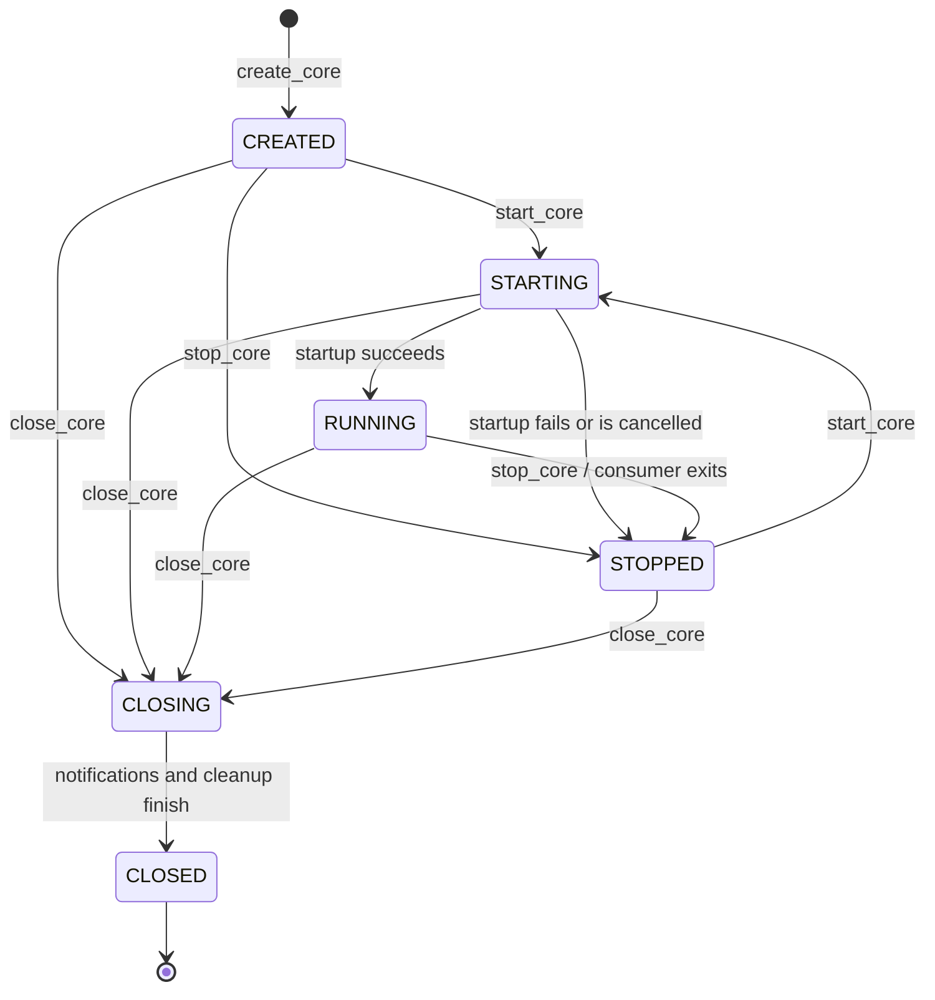

# Event core 生命周期

event core 分为五个阶段：**create → start → running → stop → close**。工厂提供四类生命周期方法：`create_core()`、`start_core()`、`stop_core()`、`close_core()`，运行阶段由启动成功后进入。

`ApixisCore` 持有 event registry、event pipe、handler registry 和 event loop，负责协调这组组件的生命周期。工厂只管理当前共享实例并转交生命周期调用；订阅、等待器和 graph 均使用这个实例。

## 阶段与状态机

| 阶段 | 方法 | 状态 | 行为 |
| --- | --- | --- | --- |
| create | `create_core()` | `CoreState.CREATED` | 同步构造组件，不启动任务或消费事件 |
| start | `await start_core()` | `CoreState.STARTING` | 启动已有组件的事件消费者，不创建组件 |
| running | 启动成功 | `CoreState.RUNNING` | 消费队列，安排前台链与后台 handler |
| stop | `await stop_core()` | `CoreState.STOPPED` | 只停止队列消费，允许再次 start |
| close | `await close_core()` | `CoreState.CLOSING` → `CoreState.CLOSED` | 永久禁入、取消、通知、汇合并释放注册 |

关闭是异步清理，因此 close 阶段区分进行中和已完成。core 只用一个状态枚举表示生命周期，不另设 started/stopped/closing 布尔组合；同一把生命周期锁串行协调启动、停止和最终清理。并发 close 共享一次清理任务。



重复 create 返回尚未关闭的同一实例；重复 start/stop 不重复创建消费者。未创建时 start 和 getter 抛出 `RuntimeError`，stop/close 直接返回。启动失败保留组件，允许重试。

关闭后 start 抛出 `CoreClosedError`。只有等待 close 完成后，显式再次 create 才会构造新实例；关闭过程中 create 抛出 `RuntimeError`。旧组件引用永久关闭，不会随新 core 重开。

## 显式创建与同步读取

```python
from apixis import create_core, get_core, get_event_pipe

core = create_core()
assert get_core() is core
pipe = get_event_pipe()
```

`get_core()`、`get_event_registry()`、`get_event_pipe()`、`get_handler_registry()`、`get_event_loop()` 都只同步读取已创建的组件，不创建组件、不安排启动，也不恢复消费。异步 `aget_*` 接口已移除。

先 create，再导入使用订阅装饰器或构图的业务模块；订阅注册与 graph 编译都不会隐式启动。也可以在应用入口中 create 后再注册业务函数。应用在需要消费时显式 start。

## stop 与 start 可逆

stop 只停止事件队列的消费：

- 已经安排的 handler chain 和后台 handler 继续正常执行，不增加暂停或准入限制。
- 管道继续接收事件。队列满时发布者按原有背压等待；start 恢复消费后继续入队。
- 队列中的事件保持原顺序。已经出队、尚在等待派发许可的事件保留其捕获的 handler 引用，恢复后继续派发。
- 注册、普通链缓存、等待者、固定等待期限和组件实例均保留。getter 不会结束暂停。

因此暂停/恢复不会丢事件。停止期间业务链等待后续队列事件时，结果依赖恢复消费；stop 不取消这类业务等待，也不替应用暂停已经安排的链。

## close 的取消顺序

1. 状态立即进入 CLOSING；底层管道永久拒绝 `put()`、`put_nowait()`、`post_event()`，唤醒满队列上的发布者并抛出 `CoreClosedError`。handler registry 同时停止接受新注册。
2. 立即向消费者、前台派发与后台 handler 任务发出取消请求。已运行任务沿协程内既有的取消路径执行清理；尚未进入协程的任务只回收资源，不补发取消通知。
3. 停止消费者后，直接清空事件队列。`_pending_dispatch` 虽已出队，但还未派发，单独丢弃并调用一次 `task_done()`。两者都不查询 handler、不执行业务或 `on_cancelled`，不增加事件分类或状态标记。
4. 在途任务沿既有 `on_cancelled` 通知清理。实际事件的等待监听通过 `_cancel()` 保留 predicate 和请求关联，匹配后完成为 `None`。
5. 遍历 `_waiter_cache` 显式记录的 waiter，对 `active=True` 的实例调用 `finish()`，直接执行 `_future.set_result(None)` 和 `close()`；不构造事件、不调用等待监听回调、不执行 predicate。此步骤在汇合所有业务清理之前完成，避免清理代码等待事件而阻塞 core 关闭。
6. 汇合前台和后台任务，释放许可；最后清理注册与事件名，进入 CLOSED。关闭流程不创建单独的取消通知任务。

取消过程中 handler 即使吞掉取消或改抛其他异常，也不会继续执行后续业务 core 或业务 on_error；异常仍记录，清理由独立的 on_cancelled 完成。

取消回调保持既有 `notify_cancelled()` 语义：异常（包括回调自行抛出的 `CancelledError`）只记录，不阻止其他通知。事件循环沿用每个取消回调 5 秒的通知上限。close 立即发出取消请求，返回则表示拥有的任务与通知已经清理完成。

调用方取消等待 close 的协程，不会中止共享清理。取消回调再次调用 close 时不等待自身；在 handler 中请求 close 的执行任务本身也会被取消。

## EventWaiter 的两类取消

| 来源 | Future 终态 | 等待结果 |
| --- | --- | --- |
| `EventWaiter.close()`、业务取消等待、正常退出未完成的等待上下文 | cancelled | `CancelledError` |
| 固定注册期限到达 | exception | `TimeoutError` |
| 匹配事件的 `on_cancelled` 通知或 core 关闭直接完成 | result | `None`，单 pattern 和多 pattern 一致 |

`EventWaiter` 使用普通 asyncio Future，并直接等待它。`active` 是只读 property，直接返回 `not _future.done()`，不维护额外状态标记。`finish()` 在调用方确认 active 后，执行 `_future.set_result(None)`，再调用 `close()` 注销监听和计时器。真实事件的 `_cancel()` 与 core 关闭都复用这个操作；core 关闭不产生任何补充通知。

缓存通过下层 `WaiterLifecycle` 协议持有 waiter，只依赖 `active` 和 `finish()`；registry/cache 不引用上层 `subscription.EventWaiter`。`EventWaiter` 构造自己的回调后，只调用一次 `register_waiter(waiter, handlers, point=...)`。registry 统一登记 waiter、全部临时 handler、组归属和匹配索引；任一 handler 注册失败时回滚本次已安装项。Future 到达任意终态后，waiter 只调用一次 `unregister_waiter()`，由 registry 一并移除该 waiter 仍拥有的全部监听。

单独按名称或组移除临时 handler 时，registry 同步更新 waiter 的归属记录，保留仍活跃 Future 的关闭追踪。handler 被同名替换后，旧 waiter 的后续清理不会删除替代者。普通 handler 使用 `register_handler()`，waiter 使用 `register_waiter()`；普通注册不接受 point。图中断通过 `post_and_wait()` 等待用户 hook 处理结束，再检查 Block 是否已完成或接受，不再创建兜底 handler 或独立 listener。

`close()` 直接调用 `_future.cancel()`；注册 handler 时，`on_cancelled` 统一指向 `_cancel()`。原有 `_resolve()` 保持不变，负责正常结果的期限检查、predicate 和聚合。若等待任务本身被取消，asyncio 仍正常向其等待的 Future 传播取消。已经完成、超时或取消的 Future 不被关闭流程改写；尚未执行的超时回调会由先到达的直接完成操作清理。

实际事件取消后，handler 的清理回调仍收到 `cancelled=True` 的原事件；waiter 的 `_cancel()` 使用 predicate 隔离并发同名请求，但匹配后只向等待方返回 `None`。取消一个请求不会提前完成其他同名请求的等待。

匹配事件尚未产生时，core 直接完成对应 waiter 的 Future，不存在合成事件、空 event_id 或特殊载荷约定。即使多 pattern 收集已经收到部分事件，关闭后的整个结果也是 `None`；已正常完成的收集仍保留原结果。

`wait()`、`get_result()`、`wait_event()`、`await_for()` 和 `post_and_wait()` 均遵守这一取消返回约定。

`EventWaiter.close()` 继续调用 `_future.cancel()`，代表业务主动放弃结果；它与超时/框架关闭不是同一条路径。

## 应用入口

```python
import asyncio
from apixis import create_core, start_core, stop_core, close_core, subscribe, post_and_wait


async def main():
    create_core()

    @subscribe("job")
    async def handle(event):
        print(event.context)

    try:
        await start_core()
        await post_and_wait(event_name="job", context={"value": 1})
        await stop_core()
        # 暂停期间可继续注册和入队；只有显式 start 才恢复消费。
        await start_core()
    finally:
        await close_core()


asyncio.run(main())
```

`get_event_runtime_status()` 同步返回不可变快照，包含 `state` 和各组件工作计数，不创建或启动 core。未创建时 `initialized=False`、`state=None`；关闭实例在下一次 create 前仍可检查。

[事件 API](./event/README.md) · [事件队列](./event/channels.md) · [接口概览](./README.md)
