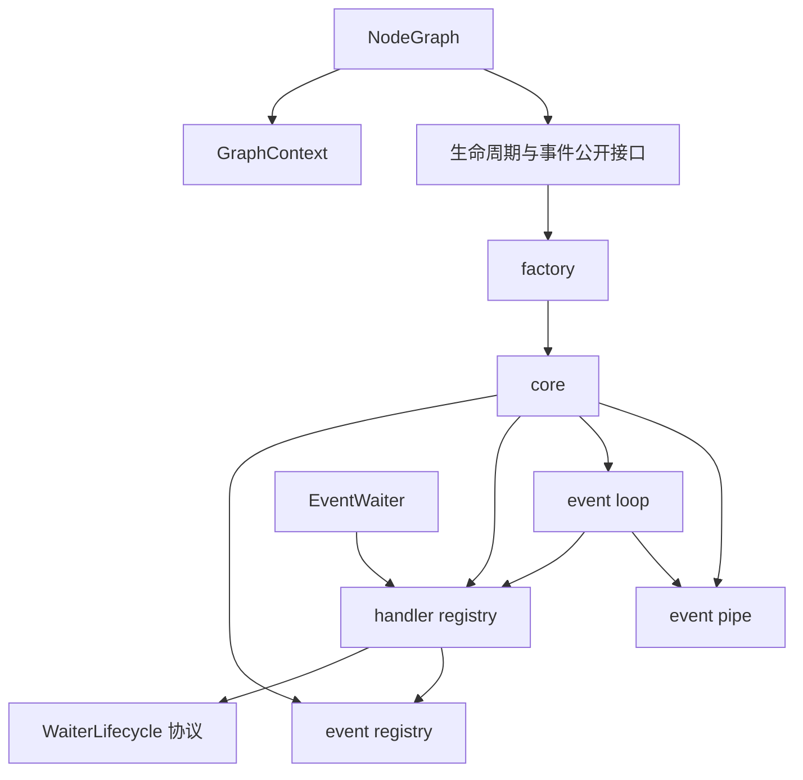

# 架构与设计取舍

当前运行时由一个共享 event core 和使用它的图执行层组成，服务于同一个 `asyncio` 事件循环。应用通过公开接口发布、订阅、等待和执行图；组件的组合、任务归属及清理由框架管理。

## 阅读入口

| 主题 | 设计关注点 |
| --- | --- |
| [生命周期](runtime-lifecycle.md) | 显式创建、共享操作 Task、暂停与关闭的不同职责、取消与等待器终态 |
| [事件派发与等待](event-dispatch.md) | 队列与许可、处理链捕获、普通与等待监听缓存、注册和注销归属 |
| [图执行与状态](graph-runtime.md) | 所属 core、执行完成信号、状态隔离、并发合并、快照及中断 |

公开接口的调用方法见[使用文档](../usage/README.md)，测试命令与结果见[测试文档](../testing/README.md)，历史问题及修复见[审查记录](../audits/README.md)。

## 组件与依赖方向

| 组件 | 拥有的状态与责任 |
| --- | --- |
| factory | 当前共享 core 的引用，显式创建及生命周期转交 |
| core | event registry、pipe、handler registry、event loop，协调生命周期和关闭完成通知 |
| event pipe | 本地有界队列、发布准入及等待入队的任务；保留载荷对象引用 |
| event loop | 一个消费者、已出队待派发事件、前台派发与后台任务、前台许可 |
| handler registry | 注册项、分组、匹配索引、普通链缓存、等待监听缓存和 waiter 归属 |
| EventWaiter | 一次收集的 Future、固定期限、predicate 和终态时的注销请求 |
| NodeGraph | 编译后的节点绑定、namespace、图订阅、活跃 context 和所属 core 的引用 |
| GraphContext | 一次执行的状态、完成 Future、流写入器及有限条快照 |

registry 对 waiter 只依赖下层的生命周期协议，不反向导入上层等待接口。event core 通过通用关闭完成回调通知上层，识别和结束图调用的责任留在图层。内部组件 getter 和实现类不作为应用接口导出，避免应用越过归属边界单独清理组件。

## 当前取舍

- 显式 `create_core()` 和 `start_core()` 分开，使导入、注册、构图和只读检查不会隐式启动任务。代价是应用必须安排启动与关闭。
- `stop_core()` 只停止消费，保留队列、注册和在途业务；`close_core()` 封闭准入并终止拥有的工作。暂停期间的业务等待可能依赖再次启动消费。
- 每种生命周期操作共用一个 Task，并使用 `shield` 隔离调用方取消。这使并发调用共享结果，也增加启停的任务和调度成本；历史测量见[生命周期性能复测](../testing/performance/2026-11-21-lifecycle-recheck.md)。
- 队列容量与前台派发许可独立，等待嵌套事件时临时归还许可。后台任务不持有前台许可，也没有独立并发上限，需要应用控制工作量。
- 普通订阅与临时等待使用独立匹配缓存，减少等待监听频繁增删对稳定订阅的影响。缓存只保存匹配结果，不改变事件观察历史，也不改变已经捕获的处理链。
- 状态在执行边界按 schema 复制，快照对完整状态深拷贝。两者分别服务于执行隔离与历史恢复，`KeepRef` 只调整前一种边界。

这些边界以当前源码为准：[core](../../src/apixis/core/event/core.py)、[派发](../../src/apixis/core/event/event_loop.py)、[注册表](../../src/apixis/core/event/handler_registry/registry.py)、[图执行](../../src/apixis/core/graph/node_graph.py)。
