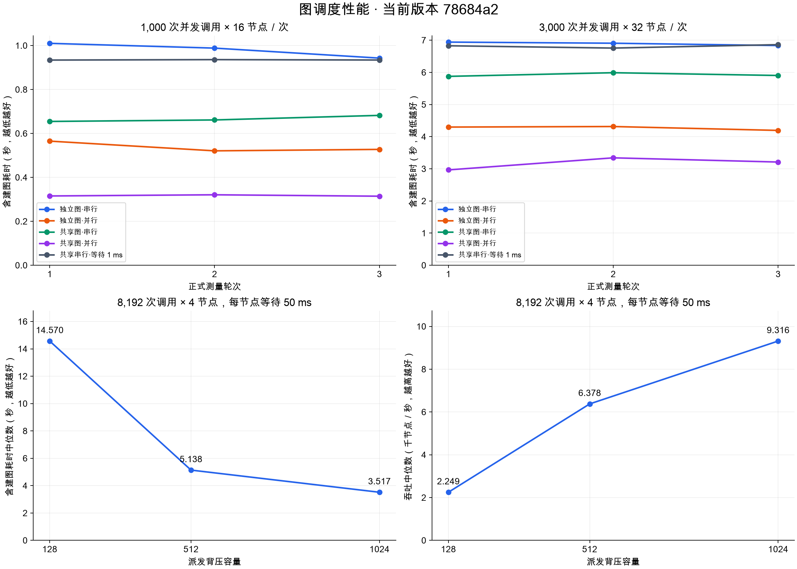
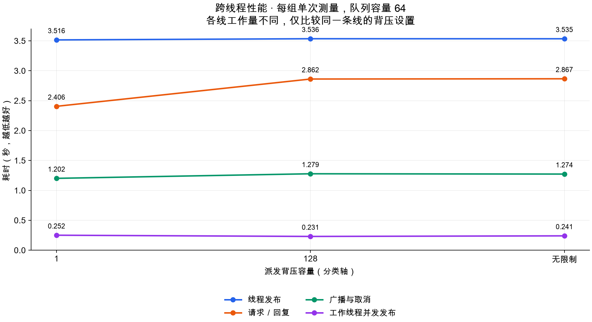
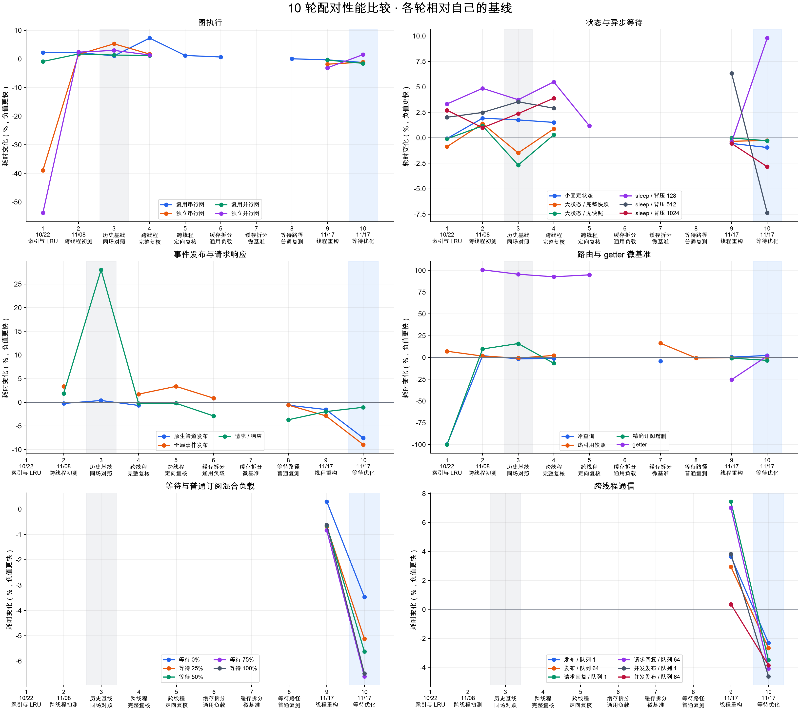
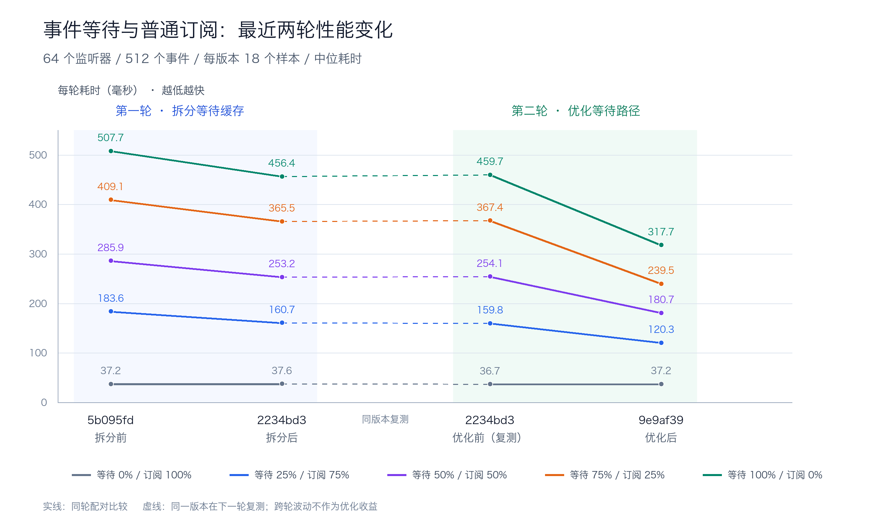

# 性能测试记录

更新于 2026-11-17。本页记录跨线程等待路径优化、线程 core 重构前后的配对对比，以及 `78684a2` 的单版性能测试，并保留此前的对比和原始数据。当前结果与历史比较分开记录，不将跨日期耗时差异解释为版本收益。

## 当前跨线程实现

- 每个线程的 `ApixEventPipe` 使用独立的有界 `asyncio.Queue`；该线程的跨线程接收队列具有相同容量，各 core 独立管理派发许可。
- 桥接入队通过异步容量通知推进，不使用默认线程池，也不保留同步阻塞提交路径。
- `ThreadEventWaiter.wait()` 在各目标 loop 重设期限，复用上下文进入时已有的结果收集任务；`get_result()` 沿用现有期限。
- 清理已完成时直接返回；单个发布任务直接等待，保留请求取消、关闭确认和许可恢复。

2026-11-15 修复验证记录：全量测试 1597 项通过，派发容量和两条队列容量均为 1 的 128 线程 debug 压力测试通过。新增回归覆盖默认／eager 调度、线程池占满、满队列、期限更新和取消。运行方式见[跨线程事件验证](../../tests/README.md#跨线程事件验证)。这些正确性及压力结果没有配对的旧版耗时，不据此计算当前实现的性能提升。

## 2026-11-17 跨线程等待路径优化

针对上轮跨线程请求／回复的回退，保留命名 core、路由锁、有界队列、监听就绪屏障、结果 Future 与清理确认，仅减少无须执行的上下文及单目标包装。生产代码改动限于 `base/process.py` 和 `subscription/waiter.py`，尚未提交。

### 改动与收益

- `suspend_process()` 在没有活跃本地处理链时直接返回空上下文，省去异步生成器；有本地许可时仍使用原来的共享许可释放、恢复及取消逻辑。返回的上下文在调用方 loop 立即进入。
- 单目标 `ThreadEventWaiter` 不再创建 `AsyncExitStack`，直接等待该目标的清理确认；收集单目标结果时不再创建多目标生成器。多目标退出栈、并发收集与失败清理保留。
- 三版本同场复测中，请求／回复耗时相对优化前降低 **3.51%／4.08%**（桥接队列 1／64）；两档均为优化后最慢样本快于优化前最快样本。相对重构前旧版的剩余耗时差为 **+0.88%／+0.83%**，样本范围重叠，不宣称完全消除差异。

| 请求／回复场景 | 重构前/ms | 优化前/ms | 优化后/ms | 相对优化前 | 相对重构前 |
| --- | ---: | ---: | ---: | ---: | ---: |
| 桥接队列 1 | 542.272 | 566.914 | 547.044 | -3.51% | +0.88% |
| 桥接队列 64 | 398.442 | 418.876 | 401.768 | -4.08% | +0.83% |

这轮中，未优化版相对旧版的请求／回复耗时为 +4.54%／+5.13%；它与上一轮的 +7.45%／+7.01% 属于不同批次测量。剩余差异直接取本轮三版本结果，没有将跨轮百分比相减或连乘。

### 三版本复测与控制场景

顺序为 **重构前 → 优化前 → 优化后 → 优化后 → 优化前 → 重构前**。去掉另一个基线后，两组比较分别形成 ABBA。六个独立进程复用同一驱动的全部 28 个场景，每进程每场景预热 1 轮、测量 5 轮，每版本每场景 10 个样本，共 **840 个正式计时样本**。工作量与下文的重构对比一致，版本分别为 `33022f6`、`78684a2`、当前工作区。

下表为每版中位数，正值表示耗时增加；结果为本轮观测，没有把小幅波动解释成稳定收益。

| 场景 | 优化前/ms | 优化后/ms | 耗时变化 |
| --- | ---: | ---: | ---: |
| 路由冷查询 | 0.912 | 0.933 | +2.25% |
| 热引用快照 | 3.648 | 3.650 | +0.06% |
| 单次订阅增删 | 0.002542 | 0.002458 | -3.30% |
| 共享串行图 | 302.712 | 298.954 | -1.24% |
| 独立串行图 | 379.658 | 375.461 | -1.11% |
| 共享并行图 | 146.998 | 144.724 | -1.55% |
| 独立并行图 | 205.923 | 209.010 | +1.50% |
| 小固定状态 | 216.227 | 214.175 | -0.95% |
| 大状态／完整快照 | 198.683 | 198.178 | -0.25% |
| 大状态／关闭快照 | 107.498 | 107.190 | -0.29% |
| 异步等待／背压 128 | 731.460 | 803.073 | +9.79% |
| 异步等待／背压 512 | 405.545 | 375.647 | -7.37% |
| 异步等待／背压 1024 | 365.884 | 355.495 | -2.84% |
| 原生管道发布 | 120.046 | 110.974 | -7.56% |
| 本地全局发布 | 125.164 | 113.967 | -8.95% |
| 本地请求／回复 | 217.506 | 215.222 | -1.05% |
| getter（200,000 次） | 27.533 | 27.984 | +1.64% |
| 混合负载／等待 0% | 37.635 | 36.330 | -3.47% |
| 混合负载／等待 25% | 118.787 | 112.705 | -5.12% |
| 混合负载／等待 50% | 178.319 | 168.299 | -5.62% |
| 混合负载／等待 75% | 235.879 | 220.302 | -6.60% |
| 混合负载／等待 100% | 317.122 | 296.529 | -6.49% |
| 跨线程发布／桥接队列 1 | 174.401 | 170.374 | -2.31% |
| 跨线程发布／桥接队列 64 | 112.650 | 109.641 | -2.67% |
| 跨线程请求／回复／桥接队列 1 | 566.914 | 547.044 | -3.51% |
| 跨线程请求／回复／桥接队列 64 | 418.876 | 401.768 | -4.08% |
| 跨线程并发发布／桥接队列 1 | 151.448 | 144.450 | -4.62% |
| 跨线程并发发布／桥接队列 64 | 173.483 | 166.798 | -3.85% |

全场测量中，背压 128 的异步等待场景出现 **+9.79%**，因此另做独立 ABBA 复核，每进程预热 1 轮、测量 18 轮，每版 36 个样本。复核结果为 **740.141 → 733.436 ms（-0.91%）**；CPU 时间中位数为 **359.179 → 355.480 ms**，前后耗时范围 **712.626–854.784／714.513–850.611 ms** 有重叠，未复现稳定的约 10% 回退。全场测量中的原值仍保留，未用复核样本替换它。

路由冷查询 +2.25%、getter +1.64% 和独立并行图 +1.50% 也完整保留；这些路径的样本范围重叠。本轮没有做逐函数耗时归因，剖析仅用于定位额外的上下文和退出栈包装，不用 profiler 时间替代正式计时。

### 正确性、指纹与复现

- 全量 **1711 passed**；asyncio debug 边界回归 **452 passed**；32 个工作线程、每线程 32 次操作、两条队列容量均为 1 的 debug 压力 **12 passed**。覆盖默认／eager 调度、源许可借出与恢复、单／多目标、超时、取消、停止和图内跨线程等待。性能计时与这些验证分开执行。
- [三版本原始报告及六份内嵌进程数据](data/2026-11-17/reply-optimization-comparison.json)
- [背压 128 独立复核：全部 72 个正式样本](data/2026-11-17/reply-optimization-sleep128-recheck.json)
- [生产代码补丁，应用于 78684a2](data/2026-11-17/reply-optimization.patch)
- [三版本运行脚本](data/2026-11-17/benchmark_reply_optimization.py)；各版本源码与驱动 SHA256 均保留在进程记录中。当前优化后源码指纹为 `b6cce2820e9f229af44f7104ddf8110898a9a1618172b4e7750fafff3fe03faa`。

```bash
.venv/bin/python docs/performance/data/2026-11-17/benchmark_reply_optimization.py \
  --pre-refactor-source /tmp/apixis-perf-baseline-33022f6/src \
  --before-source /tmp/apixis-perf-before-reply-optimization/src

.venv/bin/python scripts/benchmark_runtime.py \
  --baseline-source /tmp/apixis-perf-before-reply-optimization/src \
  --output docs/performance/data/2026-11-17/reply-optimization-sleep128-recheck.json \
  --repeats 18 --scenario sleep/capacity-128
```

两个基线目录分别由 `git archive 33022f6 src`、`git archive 78684a2 src` 提取；优化后由驱动读取当前工作区。历史总览第 10 列展示相对优化前的 28 项变化，第 9 列重构结果保留。

## 2026-11-17 线程 core 重构前后对比

本轮补做 **`33022f6`（重构前，1.4.1）→ `78684a2`（重构后，2.0.0）** 的同场 ABBA。覆盖 28 个场景，四个独立进程按 `before → after → after → before` 执行；每进程每场景预热 1 轮、测量 9 轮，每版本每场景 18 个正式样本，总计 **1,008 个正式计时样本**。两版均使用同一份当前基准驱动，结果和清理断言均通过，没有未配对场景。

### 回退与改善

- **跨线程请求／回复是本轮最明确的回退**：桥接队列 1／64 的耗时中位数分别增加 **7.45%／7.01%**。两组配对方向一致，两场景均为新版最快样本仍慢于旧版最慢样本。
- 跨线程逐次发布耗时增加 **2.94%–3.66%**；工作线程内并发发布增加 **0.36%–3.82%**。这些场景的前后样本范围有重叠，变化幅度和请求／回复分别解读。
- 背压 512 的异步等待场景耗时增加 **6.33%**，两组配对均为增加，但样本范围重叠；背压 128／1024 分别为 **-0.41%／-0.56%**。不把一个等待容量的结果外推为全部等待负载。
- 四种普通图执行耗时中位数降低 **0.33%–3.10%**；原生管道、本地全局发布和本地请求／回复分别为 **-1.53%／-2.86%／-1.97%**。
- getter 微基准耗时降低 **25.43%**，折合每次约 **185.7 ns → 138.5 ns**；这是局部热路径变化，不能换算成应用整体吞吐改善。
- 混合等待负载为 **-0.84% 至 +0.30%**。纯普通订阅的 +0.30% 及路由冷查询的 +0.43% 均有配对方向不一致与样本范围重叠，不能据此确认稳定回退。

没有适用于整次重构的单一回退率：不同路径的方向、工作量和占用比例不同。本轮主要可见成本集中在跨线程通信，未做逐函数 profiler 归因。

### 完整耗时对照

变化为 `(重构后 / 重构前 - 1) × 100%`：正值表示耗时增加，负值表示耗时降低。前后各取 18 个正式样本的中位数；不跨场景求平均。单次订阅增删保留六位毫秒小数，其余场景保留三位。

| 场景 | 重构前/ms | 重构后/ms | 耗时变化 |
| --- | ---: | ---: | ---: |
| 路由冷查询（2,000 次） | 0.896 | 0.900 | +0.43% |
| 热引用快照（30,000 次） | 3.641 | 3.633 | -0.24% |
| 精确订阅增删（单次） | 0.002687 | 0.002667 | -0.78% |
| 共享串行图 | 305.197 | 304.195 | -0.33% |
| 独立串行图 | 397.005 | 389.657 | -1.85% |
| 共享并行图 | 149.338 | 148.717 | -0.42% |
| 独立并行图 | 220.381 | 213.550 | -3.10% |
| 小固定状态 | 222.657 | 221.424 | -0.55% |
| 大状态／完整快照 | 202.357 | 201.669 | -0.34% |
| 大状态／关闭快照 | 108.925 | 108.911 | -0.01% |
| 异步等待／背压 128 | 731.966 | 728.970 | -0.41% |
| 异步等待／背压 512 | 407.941 | 433.747 | +6.33% |
| 异步等待／背压 1024 | 375.482 | 373.388 | -0.56% |
| 原生管道发布 | 123.984 | 122.085 | -1.53% |
| 本地全局发布 | 130.778 | 127.033 | -2.86% |
| 本地请求／回复 | 223.599 | 219.198 | -1.97% |
| getter（200,000 次） | 37.145 | 27.701 | -25.43% |
| 混合负载／等待占比 0% | 37.649 | 37.761 | +0.30% |
| 混合负载／等待占比 25% | 120.162 | 119.338 | -0.69% |
| 混合负载／等待占比 50% | 180.820 | 179.651 | -0.65% |
| 混合负载／等待占比 75% | 240.037 | 238.028 | -0.84% |
| 混合负载／等待占比 100% | 323.069 | 321.076 | -0.62% |
| 跨线程发布／桥接队列 1 | 172.809 | 179.129 | +3.66% |
| 跨线程发布／桥接队列 64 | 116.609 | 120.039 | +2.94% |
| 跨线程请求／回复／桥接队列 1 | 548.856 | 589.741 | +7.45% |
| 跨线程请求／回复／桥接队列 64 | 410.032 | 438.762 | +7.01% |
| 跨线程并发发布／桥接队列 1 | 153.120 | 158.975 | +3.82% |
| 跨线程并发发布／桥接队列 64 | 180.047 | 180.691 | +0.36% |

### 回退场景的范围与配对检查

下表的两组变化分别比较第 2／1 个进程与第 3／4 个进程的中位数，保留顺序敏感性；最终变化仍按前后各 18 个样本汇总计算。样本最小–最大值不是置信区间，也未剔除慢样本。

| 场景 | 旧版最小–最大/ms | 新版最小–最大/ms | 配对 1 | 配对 2 |
| --- | ---: | ---: | ---: | ---: |
| 异步等待／背压 512 | 369.603–452.259 | 366.465–475.396 | +9.87% | +5.01% |
| 跨线程发布／桥接队列 1 | 170.511–193.144 | 178.045–218.501 | +2.78% | +4.37% |
| 跨线程发布／桥接队列 64 | 113.876–120.678 | 117.508–153.449 | +3.00% | +2.92% |
| 跨线程请求／回复／桥接队列 1 | 544.208–565.978 | 575.627–595.840 | +6.67% | +6.01% |
| 跨线程请求／回复／桥接队列 64 | 401.725–421.542 | 434.750–465.796 | +8.65% | +7.06% |
| 跨线程并发发布／桥接队列 1 | 147.873–203.015 | 155.580–207.221 | +5.79% | +3.46% |
| 跨线程并发发布／桥接队列 64 | 170.327–200.543 | 175.970–201.126 | +2.44% | +1.38% |

### 工作量、边界与原始记录

- Python 3.12.12，macOS 27.2 / arm64；GC 开启，普通日志与派发打印关闭，保留 ERROR。图场景每个正式样本前执行 `gc.collect()`；未固定 CPU、未开启 asyncio debug。
- 普通图为 512 次调用 × 16 节点，串行／并行分别执行，最大快照数随步数设置。状态场景、睡眠负载沿用驱动固定参数：小状态 256 × 32、大状态 32 × 16（payload 256 项）、异步等待 2,048 × 4（每节点 10 ms），两版完全一致。
- 本地发布每轮 16,384 个事件，请求／回复每轮 2,048 次往返；混合负载每轮 512 个事件、每事件 64 个监听器。getter 每轮 200,000 次。
- 跨线程负载每轮 32 个生产者线程 × 64 次操作，派发容量 128，桥接队列分别为 1／64；事件管道容量均为 65,536。它与上一次单版压力测试中“两条队列都为 64”的负载不同，耗时不能直接拼接。
- 两版均由工作线程转交到单个主 core；重构新增的多 core 并行扩展性未纳入这组可比负载。`tracemalloc` 另行测量 Python 分配，不混入计时、不代表 RSS；完整指标在原始 JSON 中。
- [完整 ABBA：28 场景、全部样本和内嵌进程数据](data/2026-11-17/refactor-abba.json)
- [比较元数据、提交和源码／驱动指纹](data/2026-11-17/refactor-metadata.json)
- [进程 1：旧版](data/2026-11-17/refactor-abba-1-before.json)、[进程 2：新版](data/2026-11-17/refactor-abba-2-after.json)、[进程 3：新版](data/2026-11-17/refactor-abba-3-after.json)、[进程 4：旧版](data/2026-11-17/refactor-abba-4-before.json)

历史总览已加入这轮数据：第 9 列为本次重构，第 10 列蓝色区域为本次优化，新增混合负载和跨线程面板此前没有展示的数据留空。每个点仍相对各轮自己的基线，折线不表示累计版本收益。

复现时先用 `git archive 33022f6 src` 提取未修改的基线，再运行：

```bash
.venv/bin/python scripts/benchmark_runtime.py \
  --baseline-source /tmp/apixis-perf-baseline-33022f6/src \
  --output docs/performance/data/2026-11-17/refactor-abba.json --repeats 9
```

## 2026-11-17 优化前单版性能测试（78684a2）

本轮在提交 `78684a2`（2.0.0）上运行全部 **25 组性能测试，全部通过**：13 组图调度、12 组跨线程压力。测试会话耗时 **239.952 秒**。本轮测量当前版本，没有运行配对基线或 ABBA；与下方历史记录的跨日期耗时差异不作为版本优化或回退的证据。

### 环境与计时口径

- 本地日期为 2026-11-17（Asia/Shanghai）；Python 3.12.12，macOS 27.2 / arm64。普通日志与派发打印关闭，保留 ERROR；GC 开启，未开启 asyncio debug，未固定 CPU 核心。
- 常规图负载使用实际派发容量 128、事件队列容量 65,536。每组预热 1 轮、正式测量 3 轮，共 39 个正式计时样本；每轮重新建图。计时包含建图、context 准备、调度和全部调用完成，不包含结果校验与图分解。
- 50 ms 等待负载在同一进程内依次测试背压 128、512、1024，各档重新创建 core；其余参数保持一致。操作系统调度、温度和测试顺序仍会影响结果。
- 跨线程负载沿用默认工作量，每组单次测量、无独立预热，两个队列容量均为 64。耗时包含线程池创建、操作、剩余派发和清理确认；不将其当作稳定的版本性能排名。
- 跨线程场景为多个工作线程向主 core 转交请求，未测多个命名 core 并行处理的扩展性。`workers` 是生产者线程参数，额外 executor 线程不计入该参数。
- 源码与测试驱动 SHA256、完整运行命令、UTC 起止时间见 [environment.json](data/2026-11-17/environment.json)。

### 图调度结果

下面三轮耗时和吞吐量分别取各自中位数；范围为全部正式轮次的最小–最大值，没有剔除慢样本。批量完成延迟从共同的建图起点计时，P95 列为各轮 P95 的中位数，不表示线上单请求延迟。并行宽度为 4。

| 场景 | 调用数 × 节点数/次 | 背压 | 单轮中位数/s | 最小–最大/s | 吞吐中位数/节点·s⁻¹ | 批量完成 P95/ms |
| --- | ---: | ---: | ---: | ---: | ---: | ---: |
| 独立图／串行 | 1,000 × 16 | 128 | 0.988 | 0.943–1.010 | 16,188.4 | 987.5 |
| 共享图／串行 | 1,000 × 16 | 128 | 0.661 | 0.655–0.682 | 24,190.3 | 660.6 |
| 独立图／并行 | 1,000 × 16 | 128 | 0.527 | 0.521–0.565 | 30,337.5 | 526.7 |
| 共享图／并行 | 1,000 × 16 | 128 | 0.315 | 0.314–0.321 | 50,722.9 | 314.7 |
| 独立图／串行 | 3,000 × 32 | 128 | 6.907 | 6.835–6.942 | 13,898.0 | 6,903.4 |
| 共享图／串行 | 3,000 × 32 | 128 | 5.904 | 5.876–5.990 | 16,260.7 | 5,900.0 |
| 独立图／并行 | 3,000 × 32 | 128 | 4.299 | 4.195–4.316 | 22,330.9 | 4,295.4 |
| 共享图／并行 | 3,000 × 32 | 128 | 3.211 | 2.967–3.342 | 29,894.7 | 3,207.8 |
| 共享图／串行／等待 1 ms | 1,000 × 16 | 128 | 0.934 | 0.934–0.936 | 17,127.3 | 933.6 |
| 共享图／串行／等待 1 ms | 3,000 × 32 | 128 | 6.828 | 6.756–6.863 | 14,059.1 | 6,824.4 |
| 共享图／串行／等待 50 ms | 8,192 × 4 | 128 | 14.570 | 14.317–14.638 | 2,249.0 | 14,566.1 |
| 共享图／串行／等待 50 ms | 8,192 × 4 | 512 | 5.138 | 5.057–5.220 | 6,378.1 | 5,133.4 |
| 共享图／串行／等待 50 ms | 8,192 × 4 | 1024 | 3.517 | 3.465–3.634 | 9,315.8 | 3,514.8 |

1 ms 场景每次调用的第 1、5、9……个节点等待：16 节点时等待 4 次，32 节点时等待 8 次；50 ms 场景全部 4 个节点都等待。默认 state 复制、AutoMerge 和快照均保留。



图的上半部分按两档工作量分别展示三轮实测耗时；下半部分展示同一 50 ms 等待负载在三档背压下的耗时与吞吐中位数。它们不是跨版本趋势。

本轮 50 ms 异步等待负载中，背压 128／512／1024 的耗时中位数为 **14.570／5.138／3.517 秒**，节点吞吐为 **2,249.0／6,378.1／9,315.8 节点/秒**。该负载在更高容量下能容纳更多重叠的异步等待，结果不外推为 CPU 负载或所有业务都应提高背压。

### 跨线程结果

各行工作量不同，只比较同一行的容量设置。以下是每组单次测量的总耗时，不是多轮中位数。

| 负载 | 工作线程参数 | 工作量 | 背压 1/s | 背压 128/s | 不限制派发/s |
| --- | ---: | --- | ---: | ---: | ---: |
| 线程发布 | 256 | 32,768 个事件 | 3.516 | 3.536 | 3.535 |
| 请求／回复 | 128 | 8,192 次往返，16,384 个事件 | 2.406 | 2.862 | 2.867 |
| 广播与取消风暴 | 256 | 1 个事件广播给 256 个等待方，取消 8,192 次等待 | 1.202 | 1.279 | 1.274 |
| 工作线程并发发布 | 16 | 2,048 个事件，每线程并发 128 次 | 0.252 | 0.231 | 0.241 |



横轴按容量设置分类排列，“无限制”不表示数值轴上的某个有限容量。线程发布在本轮三档下耗时接近；请求／回复在容量 1 下的单次耗时较低。每组只有一个样本，不能据此认定容量 1 普遍更快。

全部跨线程场景通过顺序、丢失/重复、回包、许可恢复及清理断言；原始指标中的 `callback_errors`、`leftover_requests`、`leftover_waiters` 均为 0。主 loop 心跳持续推进。本轮未额外测量 RSS、tracemalloc 内存或 profiler。

### 原始数据与复现

- [图调度：13 组、三轮完整指标](data/2026-11-17/graph.json)
- [跨线程压力：12 组完整指标](data/2026-11-17/thread.json)
- [环境、提交与源码/驱动指纹](data/2026-11-17/environment.json)
- [文件清单及 SHA256](data/2026-11-17/manifest.json)
- [绘图脚本](data/2026-11-17/plot_results.py)、[图调度 SVG](data/2026-11-17/graph-performance.svg)、[跨线程 SVG](data/2026-11-17/thread-performance.svg)

```bash
.venv/bin/python -m pytest tests/performance --run-performance -q \
  --graph-report=docs/performance/data/2026-11-17/graph.json \
  --thread-report=docs/performance/data/2026-11-17/thread.json
```

图表使用 Matplotlib 3.11.2 和显式加载的 `Arial Unicode MS` 中文字体；文本和 JSON 均以 UTF-8 读写，设置 `axes.unicode_minus=False`，并在渲染时检查缺失字形。PNG 已栅格化，SVG 文字已转路径，查看端无需另装字体。绘图依赖安装在临时目录，没有修改项目依赖。

已有 matplotlib 环境中，可重新生成图表：

```bash
python docs/performance/data/2026-11-17/plot_results.py --history \
  --font "/System/Library/Fonts/Supplemental/Arial Unicode.ttf"
```

其他系统可用 `--font` 指定覆盖简体中文的字体文件；省略该参数会从常见中文字体中选择。

## 2026-11-08 测量概览

当轮等待路径优化相对上一版缓存拆分实现：三种混用比例耗时降低 **24.7%–34.8%**，纯等待降低 **30.9%**；常规 `wait()` 请求/响应降低 **3.7%**。普通发布和共享图调用基本持平。纯普通订阅混合负载对照为 **+1.35%**，完整保留该结果。

## 历次性能变化

共保留 **13 轮配对实验**：下面总览覆盖 10 轮通用与跨线程基准，后面的细节图覆盖另外 2 轮混合负载专项；本次还归档 1 轮背压 128 定向复核。最新三版本实验分别形成两组 ABBA，图中展示它相对优化前的变化。早期数据也纳入图片，这些历史对比中最近一次的完整原始结果保存在 `data/latest/`。

### 通用与跨线程基准：10 轮历史总览



这张图覆盖原有图执行、状态与异步等待、事件发布与请求响应、路由与 getter 的 17 类场景，并新增 5 类混合负载和 6 类跨线程场景，共 28 类。新增面板前 8 列未补录历史点，留空不代表零变化。纵轴为**每轮相对该轮自己的 before 的耗时变化**，不使用统一的历史基线；负值表示更快，正值表示更慢。缺测点留空且不跨空白连线，没有将多轮百分比累乘，也没有把连接段当作累计版本收益。

灰色区为历史优化基线同场对照，其 before 与跨线程增量测试不同；因此请求/响应 +28.01% 与跨线程初测 +1.85% 可以同时存在。回退和异常波动均保留，例如完整复核的共享串行图 +7.27%。第 9 轮保留重构对比，蓝色区域标出第 10 轮优化对比。

| 图中轮次 | 测试轮次 | 源码指纹：before → after | 每版样本数 | 场景数 |
| --- | --- | --- | --- | --- |
| 1 | 10/22 / 索引与 LRU | `df4886d` → `814a69c` | 6 | 13 |
| 2 | 11/08 / 跨线程初测 | `0152a3c` → `5b095fd` | 6 | 17 |
| 3 | 历史基线 / 同场对照 | `814a69c` → `5b095fd` | 6 | 16 |
| 4 | 跨线程 / 完整复核 | `0152a3c` → `5b095fd` | 14 | 17 |
| 5 | 跨线程 / 定向复核 | `0152a3c` → `5b095fd` | 18 | 5 |
| 6 | 缓存拆分 / 通用负载 | `5b095fd` → `2234bd3` | 18 | 4 |
| 7 | 缓存拆分 / 微基准 | `5b095fd` → `2234bd3` | 30 | 2 |
| 8 | 等待路径 / 普通复测 | `2234bd3` → `9e9af39` | 18 | 5 |
| 9 | 11/17 / 线程 core 重构 | `fbcc545` → `e325cf3` | 18 | 28 |
| 10 | 11/17 / 线程等待优化 | `e325cf3` → `b6cce28` | 10 | 28 |

全部历史汇总及图中逐点数据在 [history.json](data/history.json) 的 `comparisons` 和 `overview_chart` 字段；第 8 轮样本位于历史普通路径结果，第 9 轮完整样本见本次重构 ABBA，第 10 轮见三版本优化报告。

### 混用与纯等待：2 轮专项细节



所有点都是实际测得的中位数：实线连接同轮 ABBA 配对，虚线连接 `2234bd3` 同一版本在下一轮的复测；跨轮波动不当作代码变化的收益。图的数据保存在 [history.json](data/history.json) 的 `chart` 字段。

| 阶段 | 同轮基线 → 结果 | 等待 25% | 等待 50% | 等待 75% | 等待 100% |
| --- | --- | --- | --- | --- | --- |
| 拆分等待缓存 | `5b095fd` → `2234bd3` | -12.47% | -11.47% | -10.65% | -10.10% |
| 优化等待路径 | `2234bd3` → `9e9af39` | -24.71% | -28.88% | -34.80% | -30.89% |

百分比均为各自同轮比较的耗时变化，不把不同轮次的绝对毫秒数直接相除来计算版本收益。

## 2026-11-08 完整对比结果

### 环境与方法

- Python 3.12.12，macOS 27.0.1 / arm64，GC 开启；普通日志与派发打印关闭，保留 ERROR；未固定 CPU 核心。
- 两组 ABBA 分别运行四个独立进程，顺序为 `before → after → after → before`。每场景每进程预热一轮、测量 9 轮，每版本每场景 18 个正式样本。
- 两组共 10 个场景、360 个正式计时样本；构建计数单独插桩审计，不混入计时。
- 所有表格耗时取中位数；变化为 `(本次 / 上一版 - 1) × 100%`，负值表示更快。原始 JSON 保留未舍入值、全部轮次、工作量、环境与源码指纹。

| 项目 | SHA256 |
| --- | --- |
| 上一版源码，排除 `_version.py` | `2234bd30321aa9622348299bdcb6b8d0a0c83eeadc9524458882a02c55bfe0b1` |
| 本次源码，排除 `_version.py` | `9e9af3916e31f2bddb49b88e000950c084e5beaeb104744a411ac3b60de711ab` |
| 测试驱动 `benchmark_runtime.py` | `831201198a79c6a5e63770d553505e1467bfd03bbf32b1e4afbc1c8fee3b04ed` |

### 等待与普通订阅混合负载

比例按同一事件的 64 个匹配监听器计算。每轮依次处理 512 个事件，共 32,768 次 handler 调用。普通订阅持续注册，等待器在每次发布前重新创建，并启动真实 `get_result()` 任务。每类监听器一半精确、一半 glob，等待位置均分 received / processed；普通订阅使用三个优先级桶。派发容量 128，事件队列容量 65,536。

计时包括等待器创建、注册、等待任务、发布、完整派发与清理；普通订阅的初次注册在计时之外。各比例所需 Future 与任务数量不同，性能比较以同一行的前后版本为准。

| 场景 | 上一版 ms | 本次 ms | 耗时变化 | 吞吐变化 |
| --- | --- | --- | --- | --- |
| 0% / 100% | 36.739 | 37.236 | +1.35% | -1.34% |
| 25% / 75% | 159.775 | 120.292 | -24.71% | +32.82% |
| 50% / 50% | 254.081 | 180.710 | -28.88% | +40.60% |
| 75% / 25% | 367.383 | 239.532 | -34.80% | +53.38% |
| 100% / 0% | 459.726 | 317.708 | -30.89% | +44.70% |

| 场景 | 上一版最小–最大 ms | 本次最小–最大 ms |
| --- | --- | --- |
| 0% / 100% | 35.481–38.086 | 37.022–38.160 |
| 25% / 75% | 157.123–163.555 | 119.250–126.058 |
| 50% / 50% | 250.482–272.438 | 179.615–182.135 |
| 75% / 25% | 365.215–369.411 | 237.811–269.238 |
| 100% / 0% | 456.875–475.756 | 316.108–344.871 |

含等待四组中，本次最慢样本仍快于上一版最快样本；纯普通订阅的样本范围重叠。没有剔除慢样本。

独立审计每组同样处理 512 个事件，各进程均完成以下工作，结束时无残留等待器：

| 等待 / 订阅 | 监听器数：等待 / 订阅 | received / processed | 普通链构建次数 | 普通 callback | 等待结果 |
| --- | --- | --- | --- | --- | --- |
| 0% / 100% | 0 / 64 | 0 / 0 | 1 | 32,768 | 0 |
| 25% / 75% | 16 / 48 | 8 / 8 | 1 | 24,576 | 8,192 |
| 50% / 50% | 32 / 32 | 16 / 16 | 1 | 16,384 | 16,384 |
| 75% / 25% | 48 / 16 | 24 / 24 | 1 | 8,192 | 24,576 |
| 100% / 0% | 64 / 0 | 32 / 32 | 1 | 0 | 32,768 |

### 普通路径与请求/响应对照

| 场景 | 上一版 ms | 本次 ms | 耗时变化 | 吞吐变化 |
| --- | --- | --- | --- | --- |
| 热引用快照，30,000 次查询 | 3.686 | 3.665 | -0.57% | +0.57% |
| 共享图，512 调用 × 16 节点 | 310.883 | 311.020 | +0.04% | -0.04% |
| 原生管道，16,384 事件 | 121.995 | 121.243 | -0.62% | +0.62% |
| 全局发布，16,384 事件 | 130.709 | 129.925 | -0.60% | +0.60% |
| 请求/响应，2,048 往返 | 232.896 | 224.309 | -3.69% | +3.83% |

| 场景 | 上一版最小–最大 ms | 本次最小–最大 ms |
| --- | --- | --- |
| 热引用快照，30,000 次查询 | 3.618–3.762 | 3.623–3.751 |
| 共享图，512 调用 × 16 节点 | 306.894–329.217 | 308.056–331.362 |
| 原生管道，16,384 事件 | 120.710–123.177 | 119.374–122.315 |
| 全局发布，16,384 事件 | 129.789–132.314 | 128.625–132.491 |
| 请求/响应，2,048 往返 | 229.700–248.658 | 222.168–245.631 |

请求/响应场景使用 `wait()`，保留并发预算变更所需的通知路径，且每次往返有两个事件，因此其收益约 3.7%，与大量并发 `get_result()` 的混合负载分别解读。图的构建、准备、执行、延迟分位数及 loop lag 原始诊断均保留在普通路径 JSON 中；这轮没有重新测量内存或未列出的历史图场景。

### 剖析与实现变化

剖析覆盖等待占比 50%、100%，各 64 个监听器、每轮 256 个事件，分别运行预热、计时与审计，共创建 73,728 个等待器。优化前创建与注册累计约占 33.5%，临时链查询约 3%，普通链查询约 0.06%。累计时间包含子调用，不能相加；profiler 会放大调用成本，不用其耗时替代 ABBA 性能结论。

本次复用 handler 唯一标识生成名称，按需创建超时通知 Future，移除 `get_result()` 冗余 `shield`，并减少空缓存处理和重复 glob 判断。取消任一共享结果等待仍会关闭整个收集器，通用 handler 执行和许可交接保持原有流程。

| 剖析调用 | 上一版 | 本次 |
| --- | --- | --- |
| uuid4 | 149,088 | 75,360 |
| create_future | 296,448 | 75,264 |
| _call_soon | 374,802 | 227,346 |
| _is_glob | 293,568 | 73,920 |
| shield | 73,728 | 0 |

在该 `get_result()` 负载中，每次等待减少 3 个额外 Future、2 次调度回调和 1 次 UUID 生成。剩余成本包括等待器与 handler 对象、结果 Future、任务调度、通用状态处理以及注册和注销。

### 正确性与线程压力

| 验证 | 结果 | 用时 |
| --- | --- | --- |
| 全量正确性测试 | 1525 passed | 15.69 s |
| 标准线程压力 | 12 passed | 16.74 s |
| 容量 1 + asyncio debug + 契约测试 | 74 passed | 5.50 s |
| Ruff / `git diff --check` | 通过 | — |

以上为 2026-11-08 源码验证时记录的摘要，完整线程指标已从本地忽略目录归档。该轮全量测试覆盖共享结果取消、软超时、多事件收集，以及许可 / 队列容量 1–3 的嵌套等待、取消和恢复。

标准压力：通信和事件队列容量均为 64，未开启 asyncio debug。每种负载分别验证派发容量 1、128、无限制：

| 负载 | 工作量 | 派发容量 1 / s | 派发容量 128 / s | 不限制派发 / s |
| --- | --- | --- | --- | --- |
| 线程发布 | workers=256，events=32,768 | 2.532 | 2.700 | 2.629 |
| 请求/响应 | workers=128，events=16,384，roundtrips=8,192 | 1.863 | 1.595 | 1.551 |
| 广播与取消风暴 | workers=256，events=1，cancelled_waits=8,192 | 1.012 | 0.867 | 1.140 |
| 工作线程异步发布 | workers=16，events=2,048 | 0.270 | 0.263 | 0.295 |

容量 1 压力：通信和事件队列均为 1，实际开启 asyncio debug，32 个工作线程、每线程 16 次操作：

| 负载 | 工作量 | 派发容量 1 / s | 派发容量 128 / s | 不限制派发 / s |
| --- | --- | --- | --- | --- |
| 线程发布 | workers=32，events=512 | 0.307 | 0.350 | 0.314 |
| 请求/响应 | workers=32，events=1,024，roundtrips=512 | 0.823 | 0.673 | 0.663 |
| 广播与取消风暴 | workers=32，events=1，cancelled_waits=512 | 0.200 | 0.195 | 0.192 |
| 工作线程异步发布 | workers=32，events=512 | 0.399 | 0.413 | 0.399 |

24 组压力测量均无残留请求、等待器或回调错误，并检查事件顺序、丢失/重复、许可恢复和主循环心跳。这里的压力耗时仅为运行记录，没有与旧版本配对，不据此计算优化收益。

### 完整原始数据

- [混合负载 ABBA：四进程、全部样本及构建审计](data/latest/2026-11-08-waiter-hotpath.json)
- [普通路径 ABBA：四进程、全部样本及图诊断](data/latest/2026-11-08-waiter-hotpath-controls.json)
- [剖析：选定函数的调用次数与累计耗时](data/latest/2026-11-08-waiter-hotpath-profile.json)
- [标准线程压力：12 组完整指标](data/latest/thread-events-waiter-hotpath-2026-11-08.json)
- [容量 1 + debug：12 组完整压力指标](data/latest/thread-events-waiter-hotpath-capacity-one-2026-11-08.json)
- [正确性验证摘要](data/latest/validation.json)
- [本次相对上一版的源码补丁](data/latest/2026-11-08-waiter-hotpath.patch)
- [完整文件清单、字节数与 SHA256](data/latest/manifest.json)

`data/latest/` 同时保留八份独立进程文件，名称与两个聚合文件的 `workers[].file` 一致；聚合文件自身也完整内嵌这些进程数据。文件清单记录每个结果文件的字节数与 SHA256。

## 历史记录摘要

历史数据仅保留汇总指标、最小/最大值、工作量、内存摘要及源码/驱动指纹，集中在 [history.json](data/history.json)；旧逐轮数据和分散报告已合并清理。2026-11-08 的完整对比记录保留在 `data/latest/`；当前版本的新记录按日期归档。

| 阶段 | 结论与边界 |
| --- | --- |
| 2026-10-22：路由索引与 LRU | 独立串行图耗时 -38.94%，独立并行图 -53.81%；共享串行图 +2.20%，三档等待 +2%–3%，均保留。|
| 2026-11-08：跨线程功能 | 常见端到端场景为小幅固定开销；getter 微基准每次约增加 91 ns。共享图和背压等待曾出现较大波动，定向 ABBA 未稳定复现同等幅度。|
| 2026-11-08：历史优化基线复测 | 当轮相对 `411c0e2` 的请求/响应累计 +28.01%，与线程功能前后的变化分开记录；该数字不代表最新实现仍有相同幅度回退。|
| 2026-11-08：缓存审计 | 固定名/空链 100,000 次查询各构建 1 次；当时 512 次请求/响应的回复链重建 512 次。拆分等待缓存后普通回复链降为 1 次。|
| 2026-11-08：拆分等待缓存 | 三种混用耗时 -10.65% 至 -12.47%；纯等待 -10.10%，纯普通订阅 +0.89%。热引用快照微基准增加约 17 ns/次。|
| 2026-11-08：等待路径优化 | 在上一版之上，混用 -24.71% 至 -34.80%，纯等待 -30.89%；普通路径对照及回退值见本页完整结果。|

历史内存使用 tracemalloc 测量 Python 分配，不等同 RSS；历史图的批次 P95/P99 不能解释为线上请求延迟。不同基线、驱动、工作量和批次不拼接为统一绝对性能序列，也不将跨轮百分比相乘作为实测总收益。

## 运行新的性能比较

归档补丁针对 2026-11-08 的 `subscription.py` 布局，当前已按职责拆包，不能从当前源码反向应用该补丁恢复历史基线。复现历史数字需要当轮源码和驱动，并核对归档中的完整源码指纹。

比较当前工作区时，先准备一个完整的基线源码目录。以下假设它位于 `/tmp/apixis-before/src`，目录中包含 `apixis/`；当前版本由驱动从工作区的 `src/` 读取。新结果保存到本地测试目录，历史数据保持不变。

```bash
.venv/bin/python scripts/benchmark_runtime.py \
  --baseline-source /tmp/apixis-before/src \
  --repeats 9 --mixed-events 512 --mixed-listeners 64 \
  --scenario event/mixed-wait-0 --scenario event/mixed-wait-25 \
  --scenario event/mixed-wait-50 --scenario event/mixed-wait-75 \
  --scenario event/mixed-wait-100 --output test-results/current-waiter-hotpath.json
.venv/bin/python scripts/benchmark_runtime.py \
  --baseline-source /tmp/apixis-before/src --repeats 9 \
  --scenario registry/hot --scenario graph/shared-chain \
  --scenario event/cached-pipe --scenario event/global-post \
  --scenario event/request-reply --output test-results/current-waiter-controls.json
```

压力测试与契约验证：

```bash
.venv/bin/python -m pytest -q tests/performance/test_thread_events.py \
  --run-performance --thread-report test-results/waiter-threads.json
.venv/bin/python -m pytest -q tests/core/event/test_subscription_regressions.py \
  tests/core/event/test_thread_events.py tests/core/event/test_waiter_handler_cache.py \
  tests/core/event/test_thread_deadlocks.py \
  tests/performance/test_thread_events.py --run-performance -o asyncio_debug=true \
  --thread-workers 32 --thread-iterations 16 --thread-queue-size 1 \
  --thread-report test-results/waiter-capacity-one.json
```
