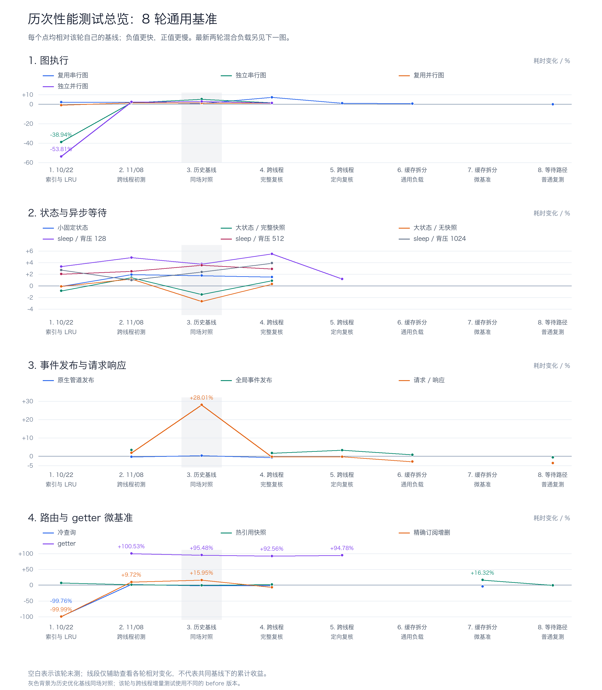
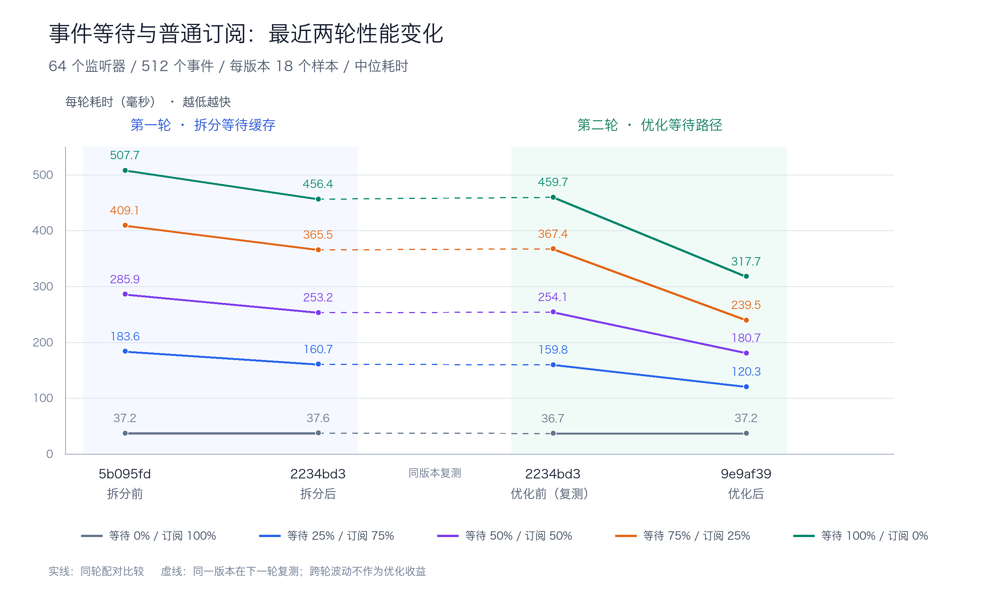

# 性能测试记录

更新于 2026-11-08。本页合并历史性能报告，保留最近一次完整测试结果；本次整理没有重跑性能测试。

最新等待路径优化相对上一版缓存拆分实现：三种混用比例耗时降低 **24.7%–34.8%**，纯等待降低 **30.9%**；常规 `wait()` 请求/响应降低 **3.7%**。普通发布和共享图调用基本持平。纯普通订阅混合负载对照为 **+1.35%**，完整保留该结果。

## 历次性能变化

共保留 **10 轮 ABBA 比较**：下面总览覆盖 8 轮通用基准，后面的细节图覆盖另外 2 轮混合负载专项。早期数据也纳入图片，最新一次完整原始结果仍保存在 `data/latest/`。

### 通用基准：8 轮历史总览



这张图覆盖图执行、状态与异步等待、事件发布与请求响应、路由与 getter 微基准的全部 17 类场景。纵轴为**每轮相对该轮自己的 before 的耗时变化**，不使用统一的历史基线；负值表示更快，正值表示更慢。缺测点留空且不跨空白连线，没有将多轮百分比累乘，也没有把连接段当作累计版本收益。

灰色区为历史优化基线同场对照，其 before 与跨线程增量测试不同；因此请求/响应 +28.01% 与跨线程初测 +1.85% 可以同时存在。回退和异常波动均保留，例如完整复核的共享串行图 +7.27%。

| 图中轮次 | 测试轮次 | 源码指纹：before → after | 每版样本数 | 场景数 |
| --- | --- | --- | --- | --- |
| 1 | 10/22 / 索引与 LRU | `df4886d` → `814a69c` | 6 | 13 |
| 2 | 11/08 / 跨线程初测 | `0152a3c` → `5b095fd` | 6 | 17 |
| 3 | 历史基线 / 同场对照 | `814a69c` → `5b095fd` | 6 | 16 |
| 4 | 跨线程 / 完整复核 | `0152a3c` → `5b095fd` | 14 | 17 |
| 5 | 跨线程 / 定向复核 | `0152a3c` → `5b095fd` | 18 | 5 |
| 6 | 缓存拆分 / 通用负载 | `5b095fd` → `2234bd3` | 18 | 4 |
| 7 | 缓存拆分 / 微基准 | `5b095fd` → `2234bd3` | 30 | 2 |
| 8 | 等待路径 / 普通复测 | `2234bd3` → `9e9af39` | 18 | 5 |

全部历史汇总及图中逐点数据在 [history.json](data/history.json) 的 `comparisons` 和 `overview_chart` 字段；第 8 轮完整样本位于最新普通路径结果。

### 混用与纯等待：2 轮专项细节



所有点都是实际测得的中位数：实线连接同轮 ABBA 配对，虚线连接 `2234bd3` 同一版本在下一轮的复测；跨轮波动不当作代码变化的收益。图的数据保存在 [history.json](data/history.json) 的 `chart` 字段。

| 阶段 | 同轮基线 → 结果 | 等待 25% | 等待 50% | 等待 75% | 等待 100% |
| --- | --- | --- | --- | --- | --- |
| 拆分等待缓存 | `5b095fd` → `2234bd3` | -12.47% | -11.47% | -10.65% | -10.10% |
| 优化等待路径 | `2234bd3` → `9e9af39` | -24.71% | -28.88% | -34.80% | -30.89% |

百分比均为各自同轮比较的耗时变化，不把不同轮次的绝对毫秒数直接相除来计算版本收益。

## 最新完整测试结果

### 环境与方法

- Python 3.12.12，macOS 27.0.1 / arm64，GC 开启；普通日志与派发打印关闭，保留 ERROR；未固定 CPU 核心。
- 两组 ABBA 分别运行四个独立进程，顺序为 `before → after → after → before`。每场景每进程预热一轮、测量 9 轮，每版本每场景 18 个正式样本。
- 两组共 10 个场景、360 个正式计时样本；构建计数单独插桩审计，不混入计时。
- 所有表格耗时取中位数；变化为 `(本次 / 上一版 - 1) × 100%`，负值表示更快。原始 JSON 保留未舍入值、全部轮次、工作量、环境与源码指纹。

| 项目 | SHA256 |
| --- | --- |
| 上一版源码，排除 `_version.py` | `2234bd30321aa9622348299bdcb6b8d0a0c83eeadc9524458882a02c55bfe0b1` |
| 本次源码，排除 `_version.py` | `9e9af3916e31f2bddb49b88e000950c084e5beaeb104744a411ac3b60de711ab` |
| 测试驱动 `benchmark_runtime.py` | `831201198a79c6a5e63770d553505e1467bfd03bbf32b1e4afbc1c8fee3b04ed` |

### 等待与普通订阅混合负载

比例按同一事件的 64 个匹配监听器计算。每轮依次处理 512 个事件，共 32,768 次 handler 调用。普通订阅持续注册，等待器在每次发布前重新创建，并启动真实 `get_result()` 任务。每类监听器一半精确、一半 glob，等待位置均分 received / processed；普通订阅使用三个优先级桶。派发容量 128，事件队列容量 65,536。

计时包括等待器创建、注册、等待任务、发布、完整派发与清理；普通订阅的初次注册在计时之外。各比例所需 Future 与任务数量不同，性能比较以同一行的前后版本为准。

| 场景 | 上一版 ms | 本次 ms | 耗时变化 | 吞吐变化 |
| --- | --- | --- | --- | --- |
| 0% / 100% | 36.739 | 37.236 | +1.35% | -1.34% |
| 25% / 75% | 159.775 | 120.292 | -24.71% | +32.82% |
| 50% / 50% | 254.081 | 180.710 | -28.88% | +40.60% |
| 75% / 25% | 367.383 | 239.532 | -34.80% | +53.38% |
| 100% / 0% | 459.726 | 317.708 | -30.89% | +44.70% |

| 场景 | 上一版最小–最大 ms | 本次最小–最大 ms |
| --- | --- | --- |
| 0% / 100% | 35.481–38.086 | 37.022–38.160 |
| 25% / 75% | 157.123–163.555 | 119.250–126.058 |
| 50% / 50% | 250.482–272.438 | 179.615–182.135 |
| 75% / 25% | 365.215–369.411 | 237.811–269.238 |
| 100% / 0% | 456.875–475.756 | 316.108–344.871 |

含等待四组中，本次最慢样本仍快于上一版最快样本；纯普通订阅的样本范围重叠。没有剔除慢样本。

独立审计每组同样处理 512 个事件，各进程均完成以下工作，结束时无残留等待器：

| 等待 / 订阅 | 监听器数：等待 / 订阅 | received / processed | 普通链构建次数 | 普通 callback | 等待结果 |
| --- | --- | --- | --- | --- | --- |
| 0% / 100% | 0 / 64 | 0 / 0 | 1 | 32,768 | 0 |
| 25% / 75% | 16 / 48 | 8 / 8 | 1 | 24,576 | 8,192 |
| 50% / 50% | 32 / 32 | 16 / 16 | 1 | 16,384 | 16,384 |
| 75% / 25% | 48 / 16 | 24 / 24 | 1 | 8,192 | 24,576 |
| 100% / 0% | 64 / 0 | 32 / 32 | 1 | 0 | 32,768 |

### 普通路径与请求/响应对照

| 场景 | 上一版 ms | 本次 ms | 耗时变化 | 吞吐变化 |
| --- | --- | --- | --- | --- |
| 热引用快照，30,000 次查询 | 3.686 | 3.665 | -0.57% | +0.57% |
| 共享图，512 调用 × 16 节点 | 310.883 | 311.020 | +0.04% | -0.04% |
| 原生管道，16,384 事件 | 121.995 | 121.243 | -0.62% | +0.62% |
| 全局发布，16,384 事件 | 130.709 | 129.925 | -0.60% | +0.60% |
| 请求/响应，2,048 往返 | 232.896 | 224.309 | -3.69% | +3.83% |

| 场景 | 上一版最小–最大 ms | 本次最小–最大 ms |
| --- | --- | --- |
| 热引用快照，30,000 次查询 | 3.618–3.762 | 3.623–3.751 |
| 共享图，512 调用 × 16 节点 | 306.894–329.217 | 308.056–331.362 |
| 原生管道，16,384 事件 | 120.710–123.177 | 119.374–122.315 |
| 全局发布，16,384 事件 | 129.789–132.314 | 128.625–132.491 |
| 请求/响应，2,048 往返 | 229.700–248.658 | 222.168–245.631 |

请求/响应场景使用 `wait()`，保留并发预算变更所需的通知路径，且每次往返有两个事件，因此其收益约 3.7%，与大量并发 `get_result()` 的混合负载分别解读。图的构建、准备、执行、延迟分位数及 loop lag 原始诊断均保留在普通路径 JSON 中；这轮没有重新测量内存或未列出的历史图场景。

### 剖析与实现变化

剖析覆盖等待占比 50%、100%，各 64 个监听器、每轮 256 个事件，分别运行预热、计时与审计，共创建 73,728 个等待器。优化前创建与注册累计约占 33.5%，临时链查询约 3%，普通链查询约 0.06%。累计时间包含子调用，不能相加；profiler 会放大调用成本，不用其耗时替代 ABBA 性能结论。

本次复用 handler 唯一标识生成名称，按需创建超时通知 Future，移除 `get_result()` 冗余 `shield`，并减少空缓存处理和重复 glob 判断。取消任一共享结果等待仍会关闭整个收集器，通用 handler 执行和许可交接保持原有流程。

| 剖析调用 | 上一版 | 本次 |
| --- | --- | --- |
| uuid4 | 149,088 | 75,360 |
| create_future | 296,448 | 75,264 |
| _call_soon | 374,802 | 227,346 |
| _is_glob | 293,568 | 73,920 |
| shield | 73,728 | 0 |

在该 `get_result()` 负载中，每次等待减少 3 个额外 Future、2 次调度回调和 1 次 UUID 生成。剩余成本包括等待器与 handler 对象、结果 Future、任务调度、通用状态处理以及注册和注销。

### 正确性与线程压力

| 验证 | 结果 | 用时 |
| --- | --- | --- |
| 全量正确性测试 | 1525 passed | 15.69 s |
| 标准线程压力 | 12 passed | 16.74 s |
| 容量 1 + asyncio debug + 契约测试 | 74 passed | 5.50 s |
| Ruff / `git diff --check` | 通过 | — |

以上为最新代码验证时记录的摘要，完整线程指标已从本地忽略目录归档。全量测试覆盖共享结果取消、软超时、多事件收集，以及许可 / 队列容量 1–3 的嵌套等待、取消和恢复。

标准压力：通信和事件队列容量均为 64，未开启 asyncio debug。每种负载分别验证派发容量 1、128、无限制：

| 负载 | 工作量 | 派发容量 1 / s | 派发容量 128 / s | 不限制派发 / s |
| --- | --- | --- | --- | --- |
| 线程发布 | workers=256，events=32,768 | 2.532 | 2.700 | 2.629 |
| 请求/响应 | workers=128，events=16,384，roundtrips=8,192 | 1.863 | 1.595 | 1.551 |
| 广播与取消风暴 | workers=256，events=1，cancelled_waits=8,192 | 1.012 | 0.867 | 1.140 |
| 工作线程异步发布 | workers=16，events=2,048 | 0.270 | 0.263 | 0.295 |

容量 1 压力：通信和事件队列均为 1，实际开启 asyncio debug，32 个工作线程、每线程 16 次操作：

| 负载 | 工作量 | 派发容量 1 / s | 派发容量 128 / s | 不限制派发 / s |
| --- | --- | --- | --- | --- |
| 线程发布 | workers=32，events=512 | 0.307 | 0.350 | 0.314 |
| 请求/响应 | workers=32，events=1,024，roundtrips=512 | 0.823 | 0.673 | 0.663 |
| 广播与取消风暴 | workers=32，events=1，cancelled_waits=512 | 0.200 | 0.195 | 0.192 |
| 工作线程异步发布 | workers=32，events=512 | 0.399 | 0.413 | 0.399 |

24 组压力测量均无残留请求、等待器或回调错误，并检查事件顺序、丢失/重复、许可恢复和主循环心跳。这里的压力耗时仅为运行记录，没有与旧版本配对，不据此计算优化收益。

### 完整原始数据

- [混合负载 ABBA：四进程、全部样本及构建审计](data/latest/2026-11-08-waiter-hotpath.json)
- [普通路径 ABBA：四进程、全部样本及图诊断](data/latest/2026-11-08-waiter-hotpath-controls.json)
- [剖析：选定函数的调用次数与累计耗时](data/latest/2026-11-08-waiter-hotpath-profile.json)
- [标准线程压力：12 组完整指标](data/latest/thread-events-waiter-hotpath-2026-11-08.json)
- [容量 1 + debug：12 组完整压力指标](data/latest/thread-events-waiter-hotpath-capacity-one-2026-11-08.json)
- [正确性验证摘要](data/latest/validation.json)
- [本次相对上一版的源码补丁](data/latest/2026-11-08-waiter-hotpath.patch)
- [完整文件清单、字节数与 SHA256](data/latest/manifest.json)

`data/latest/` 同时保留八份独立进程文件，名称与两个聚合文件的 `workers[].file` 一致；聚合文件自身也完整内嵌这些进程数据。文件清单记录每个结果文件的字节数与 SHA256。

## 历史记录摘要

历史数据仅保留汇总指标、最小/最大值、工作量、内存摘要及源码/驱动指纹，集中在 [history.json](data/history.json)；旧逐轮数据和分散报告已合并清理。最新一轮的完整记录单独保留在 `data/latest/`。

| 阶段 | 结论与边界 |
| --- | --- |
| 2026-10-22：路由索引与 LRU | 独立串行图耗时 -38.94%，独立并行图 -53.81%；共享串行图 +2.20%，三档等待 +2%–3%，均保留。|
| 2026-11-08：跨线程功能 | 常见端到端场景为小幅固定开销；getter 微基准每次约增加 91 ns。共享图和背压等待曾出现较大波动，定向 ABBA 未稳定复现同等幅度。|
| 2026-11-08：历史优化基线复测 | 当轮相对 `411c0e2` 的请求/响应累计 +28.01%，与线程功能前后的变化分开记录；该数字不代表最新实现仍有相同幅度回退。|
| 2026-11-08：缓存审计 | 固定名/空链 100,000 次查询各构建 1 次；当时 512 次请求/响应的回复链重建 512 次。拆分等待缓存后普通回复链降为 1 次。|
| 2026-11-08：拆分等待缓存 | 三种混用耗时 -10.65% 至 -12.47%；纯等待 -10.10%，纯普通订阅 +0.89%。热引用快照微基准增加约 17 ns/次。|
| 2026-11-08：等待路径优化（最新） | 在上一版之上，混用 -24.71% 至 -34.80%，纯等待 -30.89%；普通路径对照及回退值见本页完整结果。|

历史内存使用 tracemalloc 测量 Python 分配，不等同 RSS；历史图的批次 P95/P99 不能解释为线上请求延迟。不同基线、驱动、工作量和批次不拼接为统一绝对性能序列，也不将跨轮百分比相乘作为实测总收益。

## 复现最新比较

从最新源码副本反向应用已归档补丁恢复上一版；该步骤已校验恢复出的源码指纹与 `2234bd3…` 完全一致，保留当前工作区。

```bash
waiter_baseline_dir=$(mktemp -d)
waiter_patch_path="$PWD/docs/performance/data/latest/2026-11-08-waiter-hotpath.patch"
cp -R src "$waiter_baseline_dir/src"
(cd "$waiter_baseline_dir" && patch -R -p1 < "$waiter_patch_path")
.venv/bin/python scripts/benchmark_runtime.py \
  --baseline-source "$waiter_baseline_dir/src" \
  --repeats 9 --mixed-events 512 --mixed-listeners 64 \
  --scenario event/mixed-wait-0 --scenario event/mixed-wait-25 \
  --scenario event/mixed-wait-50 --scenario event/mixed-wait-75 \
  --scenario event/mixed-wait-100 --output test-results/waiter-hotpath.json
.venv/bin/python scripts/benchmark_runtime.py \
  --baseline-source "$waiter_baseline_dir/src" --repeats 9 \
  --scenario registry/hot --scenario graph/shared-chain \
  --scenario event/cached-pipe --scenario event/global-post \
  --scenario event/request-reply --output test-results/waiter-controls.json
```

压力测试与契约验证：

```bash
.venv/bin/python -m pytest -q tests/performance/test_thread_events.py \
  --run-performance --thread-report test-results/waiter-threads.json
.venv/bin/python -m pytest -q tests/core/event/test_subscription_regressions.py \
  tests/core/event/test_thread_events.py tests/core/event/test_waiter_handler_cache.py \
  tests/performance/test_thread_events.py --run-performance --asyncio-debug \
  --thread-workers 32 --thread-iterations 16 --thread-queue-size 1 \
  --thread-report test-results/waiter-capacity-one.json
```
