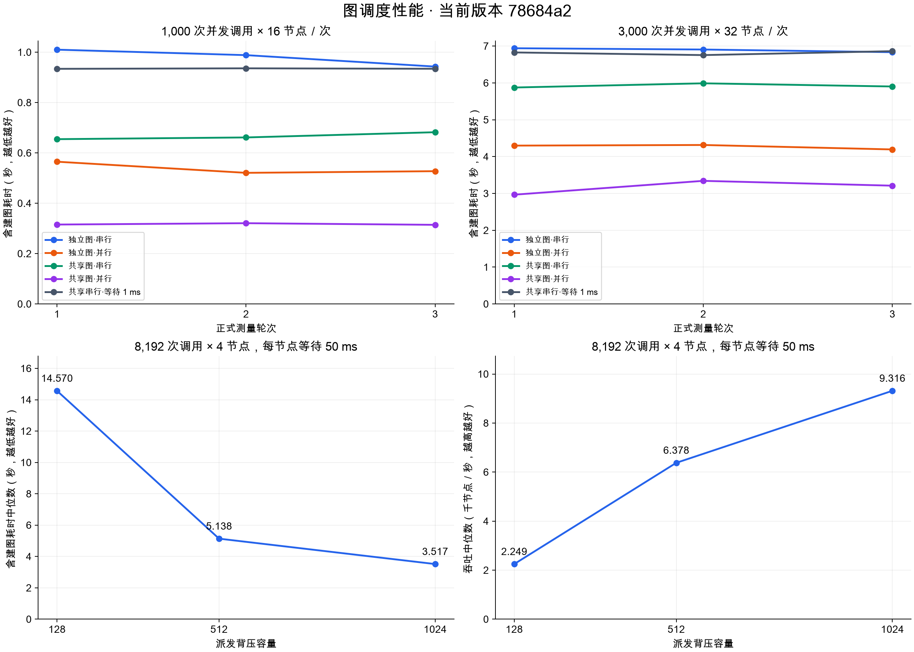

# 跨版本性能对比与历史结果

当前源码的测量入口和历史报告分开使用。历史数值属于各自冻结的源码、驱动和运行环境；比较新工作区时应保存新结果。

## 当前源码的跨版本比较

`scripts/benchmark_runtime.py` 使用四个独立进程按 `before → after → after → before` 比较。每个场景先预热，再测量；比较 JSON 内嵌各 worker 的原始轮次，不覆盖 Graph 性能测试生成的报告。

```bash
apixis_before_root=$(mktemp -d /tmp/apixis-before.XXXXXX)
git archive 4253f73 src | tar -x -C "$apixis_before_root"
.venv/bin/python scripts/benchmark_runtime.py \
  --baseline-source "$apixis_before_root/src" \
  --output /tmp/apixis-comparison.json --repeats 3
```

示例使用当前驱动支持的 `4253f73` 为基线，after 为当前仓库的 `src/`。两版使用相同参数并逐个校验结果。更早版本可能缺少驱动使用的 Logger、registry 或生命周期接口，需要选择与源码版本相配的归档驱动。

基准覆盖精确事件名冷/热查询、临时订阅增删、独立/复用图、串行/并行图、大状态快照、关闭快照、三档背压下的异步等待，以及全局发布、固定名称请求响应、getter、混合等待监听和启停/关闭。指标包含构建、准备、执行耗时，从共同启动门开始计时的批量完成延迟、事件循环延迟和普通订阅链构建次数。tracemalloc 内存是 Python 分配，不是进程 RSS。

只测当前源码的部分场景时使用单 worker：

```bash
.venv/bin/python scripts/benchmark_runtime.py \
  --worker-source src --output /tmp/apixis-local-events.json \
  --repeats 3 --events 4096 --mixed-events 128 --mixed-listeners 64 \
  --scenario event/cached-pipe --scenario event/global-post \
  --scenario event/request-reply --scenario event/mixed-wait-50
```

[Graph 性能测试](../graph-performance.md)使用 pytest 的十三组负载，保存用例总耗时、单轮指标和三档背压结果。它与此处的跨版本比较是两个独立入口。

## 当前缓存验证

```bash
.venv/bin/python scripts/audit_handler_chain_cache.py \
  --output /tmp/apixis-cache-audit.json
```

缓存审计覆盖真实派发、停止重启、graph、固定回包名称、受控重注册、过滤列表及元数据快照隔离和注销后的清理。工具内部也检查 handler 的 `register()`，这不代表该内部类型重新成为应用接口。`findings` 中存在实际缺陷时返回非零；应用更新订阅使用 `subscribe()`。

## 历史测量报告

| 报告 | 比较范围 | 适用边界 |
| --- | --- | --- |
| [2026-11-20 共享 core 性能核对](./2026-11-20-single-core-recheck.md) | `f8e885d` 与查询入口优化前的冻结重建快照，另补测 `5049c7d` | after 以 metadata 的源码指纹为准 |
| [2026-11-20 显式生命周期验证](./2026-11-20-runtime-lifecycle.md) | `a2a288a` 与当时显式生命周期快照 | 后续 waiter 注册/取消调整尚未计时 |
| [2026-11-21 生命周期性能复测](./2026-11-21-lifecycle-recheck.md) | `f09f638` 与冻结 after，主对照 25 项及独立复测 | after 与 `a93d34e` 的源码指纹一致，不含 `_version.py` |

11 月 21 日报告提供固定源码与归档驱动的完整复现命令。11 月 20 日报告保留当时 after 指纹，但没有完整 after 源码归档；重测时须另行取得符合指纹的快照。不能用新工作区结果替代历史对照。

查询回退的代码定位与修复过程归入审查文档：[handler 查询回退定位](../../audits/2026-11-20-handler-query-cause.md)、[handler 查询入口优化](../../audits/2026-11-20-handler-query-optimization.md)。

## 保留的历史数据

| 记录 | 内容 |
| --- | --- |
| [性能历史](data/history.json) | 历次配对比较与测量说明，含当前已移除架构的历史结果 |
| [等待热路径](data/latest/2026-11-08-waiter-hotpath.json) | 等待监听独立缓存前后的配对数据 |
| [热路径控制组](data/latest/2026-11-08-waiter-hotpath-controls.json) | 混合监听及普通派发控制组 |
| [热路径采样](data/latest/2026-11-08-waiter-hotpath-profile.json) | 当时的调用开销证据 |
| [Graph 测量](data/2026-11-17/graph.json) | 2026-11-17 的 graph 性能原始数据 |
| [结构重构比较](data/2026-11-17/refactor-abba.json) | 当时架构变更的配对比较，含本地控制组 |
| [等待优化比较](data/2026-11-17/reply-optimization-comparison.json) | 当时等待优化与本地控制组的配对数据 |



归档统一保存在本目录的 `data/` 中，manifest 校验保留文件的大小和 SHA256。混合历史记录和历史补丁保持原始测量内容，不能应用到当前运行时或作为当前 API 示例。纯跨线程基准及图表已经移除，原始文件可从 Git `612d5d0` 查阅。

归档脚本保留测量时的内容。`2026-11-17/benchmark_reply_optimization.py` 从自身目录向上四层定位源码仓库，复跑时须在独立历史源码树恢复测量时的目录层级；其他报告按各自的复现步骤选择源码和驱动。

[测试说明](../README.md) · [文档首页](../../README.md)
